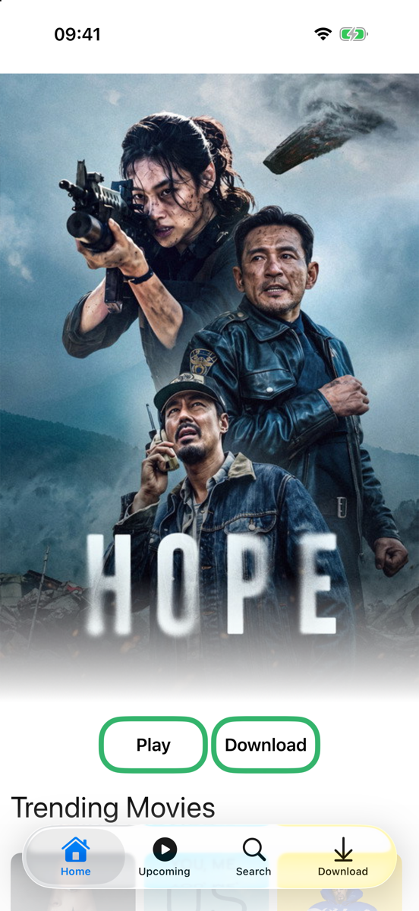
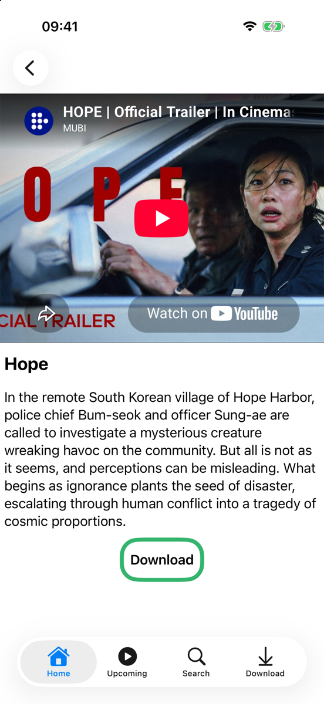
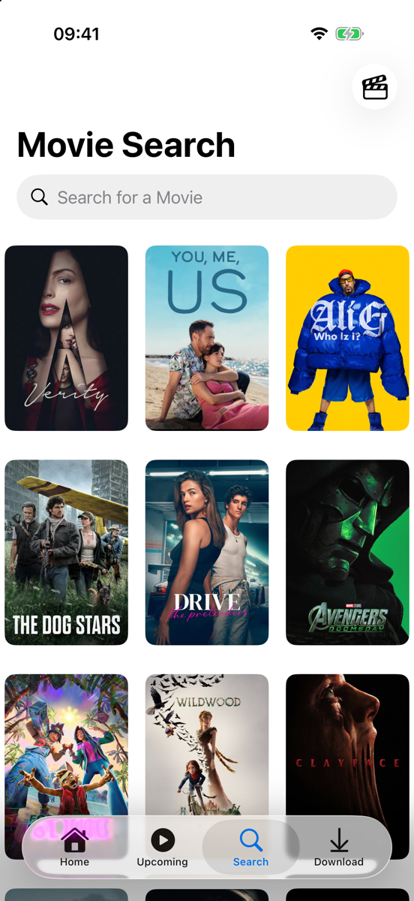

# TV Story Board

A SwiftUI app for iPhone where you browse trending and top-rated movies and TV shows, watch trailers, and keep a personal watchlist on the device.

<p align="center">
  
  
  
</p>

## Features

- **Home**: a featured title plus scrolling rows of trending and top-rated movies and TV shows.
- **Trailers**: tap any poster to open its detail page and play the YouTube trailer inline.
- **Upcoming**: a list of movies coming soon.
- **Search**: live search with debounced typing and a toggle between movies and TV.
- **Downloads**: save titles to a local watchlist with SwiftData. Swipe left to remove one.

## Tech stack

| Area | What's used |
| --- | --- |
| UI | SwiftUI (`TabView`, `NavigationStack`, `searchable`, `AsyncImage`) |
| State | `@Observable` view models |
| Concurrency | `async`/`await`, `async let` for parallel requests |
| Persistence | SwiftData (`@Model`, `@Query`) |
| Networking | `URLSession` with a generic `Decodable` fetcher |
| Video | `WKWebView` wrapped in `UIViewRepresentable` for the YouTube embed |
| APIs | [TMDB](https://www.themoviedb.org/documentation/api), [YouTube Data API v3](https://developers.google.com/youtube/v3) |

## Project structure

```
TV Story Board/
├── TV_Story_BoardApp.swift    App entry point, SwiftData container
├── ContentView.swift          Tab bar
├── HomeView.swift             Featured title + horizontal rows
├── UpcomingView.swift         Upcoming movies list
├── SearchView.swift           Movie/TV search grid
├── DownloadView.swift         Saved titles (SwiftData)
├── TitleDetailView.swift      Trailer, overview, save button
├── HorizontalListView.swift   Reusable poster row
├── VerticalListView.swift     Reusable poster list
├── YoutubePlayer.swift        WKWebView trailer player
├── ViewModel.swift            Home / upcoming / trailer state
├── SearchViewModel.swift      Search state
├── DataFetcher.swift          TMDB + YouTube networking
├── APIConfig.swift            Loads keys from APIConfig.json
├── Title.swift                SwiftData model + TMDB decoding
└── Constants.swift            Strings, icons, button styles
```

## Getting started

**Requirements:** Xcode 26.5 or newer, iOS 26.5+ (simulator or device).

1. Clone the repo:
   ```bash
   git clone https://github.com/yookobtw/Movie-TVTracker.git
   ```
2. Get API keys:
   - TMDB: create an account and request an API key at [themoviedb.org/settings/api](https://www.themoviedb.org/settings/api).
   - YouTube: enable **YouTube Data API v3** in the [Google Cloud Console](https://console.cloud.google.com/apis/library/youtube.googleapis.com) and create an API key.
3. Copy the config template and add your keys:
   ```bash
   cp APIConfig.example.json "TV Story Board/APIConfig.json"
   ```
   `APIConfig.json` is in `.gitignore`, so your keys stay out of git.
4. Open `TV Story Board.xcodeproj`, pick a simulator, and press **Run**.

## Roadmap

- Ratings and a "watched" list
- Pull to refresh and pagination
- Release dates and genres on the detail page

## Credits

This product uses the TMDB API but is not endorsed or certified by TMDB. Trailers are provided by YouTube.
